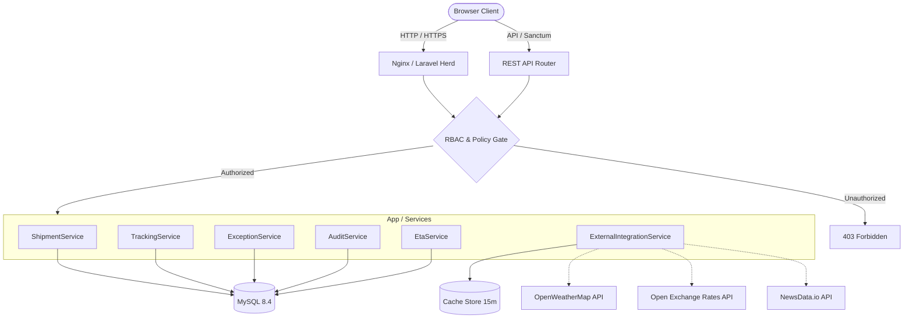
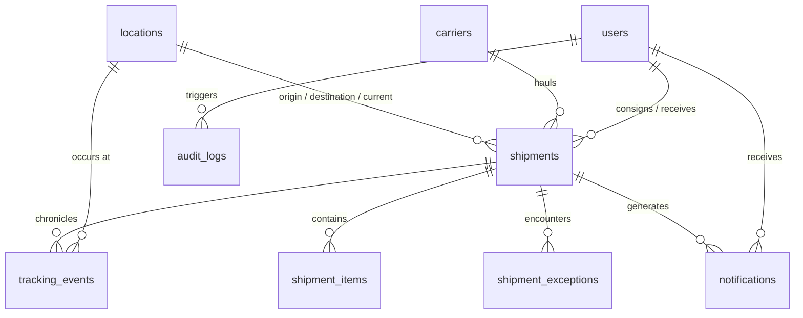

# CargoTrace: Global Ocean Container Shipment Visibility & Tracking Platform

[](https://laravel.com)
[](https://php.net)
[](https://tailwindcss.com)
[](https://leafletjs.com)
[](https://www.chartjs.org)
[-10B981?style=flat)](https://pestphp.com)

> **Academic Capstone Project**  
> Course: Web Programming / Final Individual Project  
> Domain: Enterprise Ocean Container Shipping & Maritime Logistics Visibility  
> Local Dev URL: `http://cargotrace.test` (Laravel Herd) or `http://localhost:8000` (Docker)

---

## 1. Quick Links to Project Artifacts
- **[Comprehensive Technical Documentation (EN)](docs/TECHNICAL_DOCUMENTATION.md)**: Full architecture breakdown, 10-table data dictionary, Mermaid ERD with cardinalities, deterministic delay engine specifications, and group evaluation scenarios.
- **[Postman API Collection v2.1](docs/CargoTrace.postman_collection.json)**: Complete Sanctum REST API collection covering authentication, waybill lifecycle, tracking checkpoints, operational exceptions, master data, and external telemetry with pre-request token scripts.
- **[Continuous Integration Workflow](.github/workflows/ci.yml)**: Automated GitHub Actions pipeline verifying migrations, asset compilation, and Pest test suite execution.

---

## 2. Problem Statement & System Overview

International ocean container shipping powers global commerce, yet container visibility remains fragmented across heterogeneous carrier portals and transshipment hubs. Shippers face critical visibility barriers:
- **Blind Transits & Unannounced Schedule Deviations:** Adverse oceanic weather and seaport terminal congestion cause unannounced delays without automated customer notifications.
- **Cross-Border Multi-Currency Friction:** Bills of lading and manifests are billed in divergent sovereign currencies (EUR, GBP, SGD, CNY), hindering consolidated portfolio valuation.
- **Multi-Tenant Data Privacy:** Consignees require full operational visibility into their containers without accessing proprietary pricing or trade lanes of competing shippers.

**CargoTrace** solves these problems with an enterprise-grade maritime visibility platform featuring:
- **Pure Maritime Domain:** 100% focused on ocean container carriers (Maersk, MSC, CMA CGM, COSCO, Hapag-Lloyd, ONE) and verified UN/LOCODE container seaports.
- **Deterministic Delay & ETA Engine:** Rigorous, reproducible schedule variance calculation ($LOW \le 6\text{h}$, $MEDIUM \le 24\text{h}$, $HIGH > 24\text{h}$) with automated customer alerts.
- **Dual-Theme Enterprise UI (Light & Dark Mode):** Zero-flicker CSS custom property engine with dynamic OpenStreetMap tile filter synchronization.
- **Multi-Tenant Role-Based Access Control (RBAC):** Distinct permission boundaries and automated query scoping for `admin`, `operator`, and `customer` personas.
- **Truthful Telemetry Provenance:** Explicit provenance badges (`LIVE`, `CACHED`, or `SIMULATED`) ensuring academic integrity and operational transparency.

---

## 3. System Architecture & Entity Relationships

### Architecture Topology


### Entity Relationship Diagram (Summary)

*(For complete ERD details and data dictionary for all 10 tables, refer to [Technical Documentation](docs/TECHNICAL_DOCUMENTATION.md)).*

---

## 4. Technology Stack

| Layer | Technology | Purpose |
|---|---|---|
| **Backend Framework** | Laravel 13.x (PHP 8.3+) | Full-stack MVC architecture, Service layer, Sanctum API auth, Pest tests |
| **Database** | MySQL 8.4 (InnoDB) / SQLite (in-memory tests) | Relational persistence, transactional data integrity |
| **Frontend Styling** | Tailwind CSS v4 via `@tailwindcss/vite` | Semantic CSS custom property dual-theme engine (`data-theme="dark"` / `light"`) |
| **Geospatial Mapping** | Leaflet.js v1.9.4 | OpenStreetMap with dynamic CartoDB Positron & Dark Matter basemaps |
| **3D Route Globe** | Globe.gl / Three.js | WebGL interactive 3D global container trade lane visualization |
| **Data Analytics** | Chart.js v4.4 | Responsive container lifecycle doughnut and operational variance charts |
| **Typography** | Plus Jakarta Sans & JetBrains Mono | Self-hosted typography bundled via Vite |

---

## 5. Installation & Setup

### Option A: Local Development (Laravel Herd / CLI)

#### Prerequisites
- PHP 8.3 or higher with extensions: `pdo`, `pdo_mysql`, `curl`, `mbstring`, `openssl`, `bcmath`, `intl`
- Composer 2.x
- Node.js 20+ & npm
- MySQL 8.0+ running on `127.0.0.1:3306`

#### Setup Steps
```bash
# 1. Clone repository
git clone https://github.com/your-username/cargotrace.git
cd cargotrace

# 2. Install backend dependencies
composer install

# 3. Environment configuration
cp .env.example .env
php artisan key:generate

# 4. Database configuration (configure your DB credentials in .env)
# DB_CONNECTION=mysql
# DB_HOST=127.0.0.1
# DB_PORT=3306
# DB_DATABASE=cargotrace
# DB_USERNAME=root
# DB_PASSWORD=

# 5. Execute migrations and seed demo maritime data
php artisan migrate --seed

# 6. Install frontend packages and build assets
npm install
npm run build

# 7. Start local development server (if not using Laravel Herd)
php artisan serve
```

---

### Option B: Docker Containerized Setup

CargoTrace includes a production-ready `Dockerfile` and `docker-compose.yml` defining the application server and MySQL 8.4 service:

```bash
# 1. Build and start containers in the background
docker compose up -d --build

# 2. Run migrations and seed data inside the container
docker compose exec app php artisan migrate --seed

# 3. Access application
# Web App: http://localhost:8000
# Database: localhost:3306 (user: cargotrace / password: secret_password)
```

---

## 6. Demo Accounts & Credentials

The database seeder provisions pre-configured personas with default password: `password`.

| Role | Email | Company Affiliation | Access Scope |
|---|---|---|---|
| **Admin** | `admin@cargotrace.test` | CargoTrace HQ Operations | Universal Control, User Mgmt, Settings, Audit Logs |
| **Operator** | `operator@cargotrace.test` | Port Operations Center | Waybills, Checkpoints, Exceptions Resolution |
| **Customer** | `customer@cargotrace.test` | Pacific Electronics Trade | Consigned Shipments & In-App Notifications |
| **Customer 2** | `customer2@cargotrace.test` | Nordic Pharma Logistics | Consigned Shipments & In-App Notifications |

> **Pro-Tip:** The `/login` page features 1-click Quick Demo buttons to authenticate instantly as any role.

---

## 7. Automated Test Suite

The entire application is verified using **Pest PHP** against an isolated in-memory SQLite database, guaranteeing zero side-effects on local MySQL development data.

```bash
# Run complete test suite (67 tests, 382 assertions)
php artisan test

# Run feature-specific test suites
php artisan test --filter=CustomerScopeTest
php artisan test --filter=DelayThresholdSettingsTest
php artisan test --filter=AdminUserManagementTest
php artisan test --filter=ShipmentCsvExportTest
php artisan test --filter=CarrierLocationManagementTest
```

**Verification Results:**
- **67 passed tests** (100% green)
- **382 assertions** validating authorization policies, customer query scoping, terminal status locks, delay recalculations, and external API fallbacks.

---

## 8. Anti-Slop Design Principles Adherence

This project strictly adheres to the Anti-Slop design guidelines (`.claude/skills/anti-slop/antislop.md`):
- **No Marketing Fluff or Pseudo-AI:** Removed all fake AI routing sparkles (`✨`) and marketing claims; replaced with transparent, deterministic delay variance formulas.
- **Dual-Theme Synchronicity:** Eliminated hardcoded dark backgrounds. Light mode provides high-contrast `#F1F5F9` surfaces with `#0F172A` headings; dark mode maintains deep ocean maritime elegance (`#050811`).
- **Honest Telemetry:** All live third-party callouts clearly indicate data provenance (`LIVE`, `CACHED`, or `SIMULATED`).
- **Strict Role Isolation:** Every customer query is bounded by multi-tenant security guarantees.

---

## 9. Academic Integrity Statement

- **Individual Work:** This project was designed and implemented as an individual final project submission for Web Programming.
- **Truthful Telemetry:** Vessel coordinates, port milestones, and delay classifications operate deterministically through database records and operator entries. External APIs (OpenWeatherMap, Open Exchange Rates, NewsData.io) feature transparent fallback flags.
- **Pair Programming Oversight:** Generative AI tools were utilized in a pair-programming capacity for boilerplate scaffolding, test authoring, and documentation polishing under developer oversight.

---

&copy; 2026 CargoTrace &bull; Global Ocean Container Shipment Visibility & Tracking Platform
