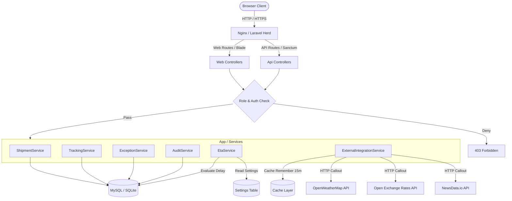
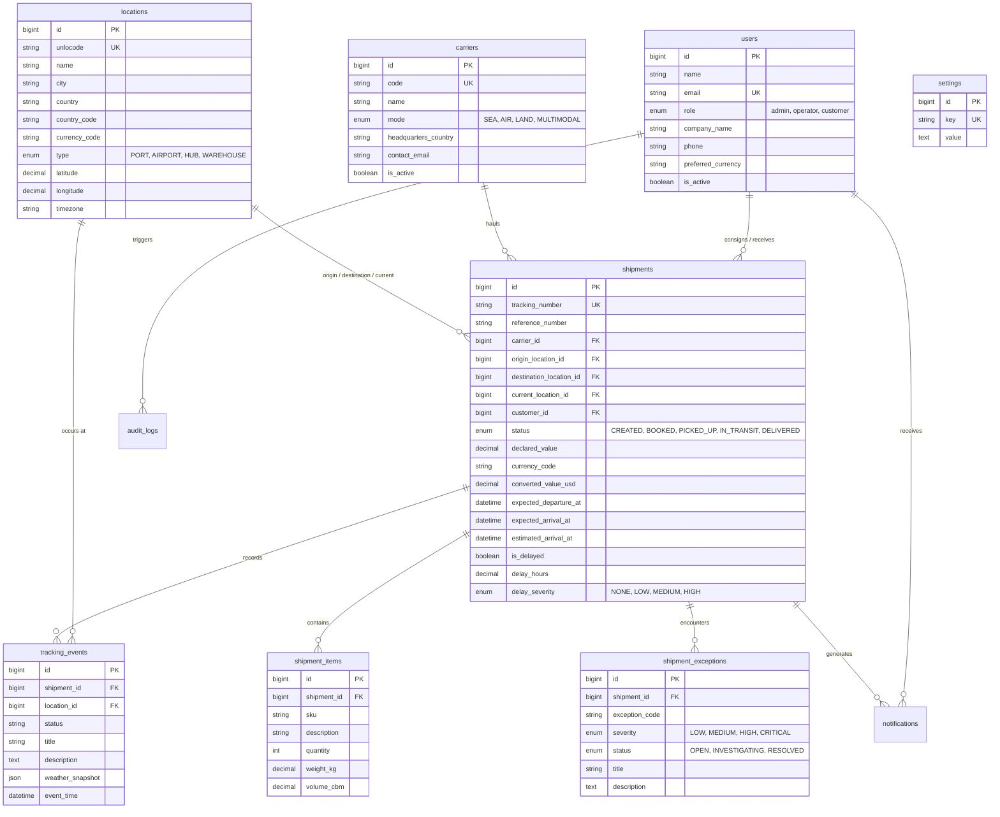

# CargoTrace: Global Shipment Visibility & Tracking Platform

[](https://laravel.com)
[](https://php.net)
[](https://tailwindcss.com)
[](https://leafletjs.com)
[](https://www.chartjs.org)
[](https://pestphp.com)

> **Academic Capstone Project**  
> Course: Web Programming / Final Individual Project  
> Domain: Enterprise Supply Chain & Maritime Logistics Visibility  
> Local Dev URL: `http://cargotrace.test` (Laravel Herd)

---

## 1. Problem Statement & Overview

Modern international trade relies on multi-modal freight networks spanning container shipping lines, air cargo carriers, and bonded intermodal terminals. However, freight visibility is frequently fragmented across disparate proprietary portals, presenting key operational challenges:
- **Blind Transits & Inaccurate ETAs:** Variations in port gate congestion and adverse maritime weather frequently cause unannounced shipment delays.
- **Cross-Border Valuation Complexity:** Cargo manifests are quoted in diverse national currencies (EUR, IDR, SGD, CNY, GBP), obscuring consolidated portfolio valuation in base currency (USD).
- **Security & Multi-Tenant Isolation:** Shippers (Customers) require complete visibility over their consigned containers without exposing proprietary commercial pricing or competitor trade lanes.

**CargoTrace** addresses these challenges by providing a centralized, enterprise-grade logistics command center featuring operator-recorded checkpoints, verified UN/LOCODE port milestones, dynamic foreign exchange conversion, live port weather telemetry, automated delay severity categorization, and strict role-based access control.

---

## 2. Key Features

### A. Real-Time Multi-Modal Shipment Tracking
- Strict 5-stage status lifecycle: `CREATED` &rarr; `BOOKED` &rarr; `PICKED_UP` &rarr; `IN_TRANSIT` &rarr; `DELIVERED`.
- Terminal enforcement: Once marked `DELIVERED`, shipments cannot be rolled back or modified.
- Full manifest recording including cargo items, quantities, volume (CBM), and hazardous material flags.

### B. Geospatial Leaflet.js Mapping with Geodesic Bezier Arcs
- Dark CartoDB Matter tile layer optimized for low-light enterprise logistics monitoring.
- Dynamic **quadratic Bezier curve calculation** approximating Great Circle navigational routes between ports without heavy external map libraries.
- Interactive layer filters: Toggle between **All Active Routes**, **Delayed Corridors**, and **Active Incidents**.
- Rich marker popups detailing UN/LOCODE, facility classification (Port, Airport, Hub, Warehouse), and port-local weather.

### C. Truthful External API Telemetry Integration
- **Weather Telemetry:** Integration with OpenWeatherMap API for live checkpoint temperature, wind, and atmospheric pressure.
- **Currency FX Matrix:** Automated conversion of declared cargo values to USD using Open Exchange Rates API (`open.er-api.com`).
- **Global News Wire:** Automated ingestion of global supply chain dispatches and port advisories via NewsData.io.
- **Honesty in Telemetry:** All telemetry cards feature a visible provenance badge (`LIVE`, `CACHED`, or `SIMULATED`), ensuring academic and operational transparency when running on simulated fallback data.

### D. Dynamic ETA & Variance Engine
- Compares `estimated_arrival_at` with `expected_arrival_at`.
- Calculates variance in hours and assigns severity based on database-configured thresholds:
  - $\le 0\text{ hours}$: `NONE` (`is_delayed = false`)
  - $> 0\text{ to } \le 6\text{ hours}$: `LOW`
  - $> 6\text{ to } \le 24\text{ hours}$: `MEDIUM`
  - $> 24\text{ hours}$: `HIGH`
- Dispatches in-app notifications to customers whenever variance escalates.
- **Admin Settings Console:** Allows runtime configuration of thresholds and bulk re-evaluation of all active line hauls.

### E. Role-Based Access Control (RBAC) & Multi-Tenant Scoping
- **Admin:** Universal system control, user management, carrier/location registry, audit logs, delay threshold settings.
- **Operator:** Waybill creation, status progression, checkpoint recording, exception reporting, and incident resolution.
- **Customer:** Scoped visibility limited strictly to their own shipments, milestones, and notifications.

### F. Public Waybill Gateway & CSV Manifest Export
- Public tracking route (`GET /track/{tracking_number}`) with rate limiting (`throttle:30,1`) displaying sanitized telemetry (no customer identity or declared valuation exposed).
- Filterable CSV manifest streaming for operations and reporting.

---

## 3. System Architecture



---

## 4. Entity Relationship Diagram (ERD)



---

## 5. Technology Stack

| Layer | Technology | Purpose |
|---|---|---|
| **Backend Framework** | Laravel 13.x (PHP 8.3+) | Full-stack architecture, Service layer, Sanctum API auth, Pest tests |
| **Database** | MySQL 8.4 (Local Herd) / SQLite (in-memory tests) | Relational persistence, transactional data integrity |
| **Frontend Styling** | Tailwind CSS v4 via `@tailwindcss/vite` | Modern dark maritime theme (`#050B14`, `#0B1728`, amber & teal accents) |
| **UI Components** | Blade Components | 14 modular components (`<x-card>`, `<x-stat-card>`, `<x-table>`, etc.) |
| **Client Scripts** | Vanilla JavaScript (ES Modules) | Lightweight bundled modules (`map.js`, `charts.js`, `tracking.js`, `ui.js`) |
| **Maps & Geospatial** | Leaflet.js v1.9.4 | Interactive OpenStreetMap with Quadratic Bezier navigation curves |
| **Data Analytics** | Chart.js v4.4 | Doughnut lifecycle, carrier bar chart, and 8-week trend graphs |
| **Font Typography** | Plus Jakarta Sans & JetBrains Mono | Self-hosted local font bundling via Vite plugin |

---

## 6. Installation & Local Setup

### Prerequisites
- PHP 8.3 or higher with extensions: `pdo`, `pdo_mysql`, `curl`, `mbstring`, `openssl`
- Composer 2.x
- Node.js 20+ & npm
- Laravel Herd or local MySQL server running on `127.0.0.1:3306`

### Setup Instructions

```bash
# 1. Clone repository
git clone https://github.com/your-username/cargotrace.git
cd cargotrace

# 2. Install backend dependencies
composer install

# 3. Environment configuration
cp .env.example .env
php artisan key:generate

# 4. Database configuration (configure your DB credentials in .env)
# DB_CONNECTION=mysql
# DB_HOST=127.0.0.1
# DB_PORT=3306
# DB_DATABASE=cargotrace
# DB_USERNAME=root
# DB_PASSWORD=

# 5. Execute migrations and seed demo data
php artisan migrate --seed

# 6. Install frontend packages and build assets
npm install
npm run build

# 7. Start local development server (if not using Laravel Herd)
php artisan serve
```

---

## 7. Demo Accounts & Credentials

The database seeder provisions accounts for each role with default password: `password`.

| Role | Email | Company Affiliation | Access Scope |
|---|---|---|---|
| **Admin** | `admin@cargotrace.test` | CargoTrace HQ Operations | Universal Control, User Mgmt, Settings, Audit Logs |
| **Operator** | `operator@cargotrace.test` | Port Operations Center | Waybills, Checkpoints, Exceptions Resolution |
| **Customer** | `customer@cargotrace.test` | Pacific Electronics Trade | Consigned Shipments & In-App Notifications |
| **Customer 2** | `customer2@cargotrace.test` | Nordic Pharma Logistics | Consigned Shipments & In-App Notifications |

> **Tip:** The `/login` page features 1-click Quick Demo buttons to log in instantly as any role.

---

## 8. Automated Testing Suite

The application is thoroughly verified using [Pest PHP](https://pestphp.com). Tests execute against an isolated in-memory SQLite database configured in `phpunit.xml` to prevent altering local development MySQL records.

```bash
# Run complete test suite
php artisan test

# Run feature-specific test suites
php artisan test --filter=CustomerScopeTest
php artisan test --filter=DelayThresholdSettingsTest
php artisan test --filter=AdminUserManagementTest
php artisan test --filter=ShipmentCsvExportTest
php artisan test --filter=ExternalIntegrationCachingTest
```

**Test Coverage Summary:**
- 44+ automated feature and unit tests passing cleanly.
- Over 315 assertions covering authentication, authorization policies, customer data scoping, external API failure fallbacks, and boundary conditions.

---

## 9. Academic Integrity & Evaluation Statement

- **Individual Work:** This project was developed as an individual final project submission for Web Programming.
- **Truthful Telemetry Disclaimer:** AIS vessel tracking, satellite feeds, and artificial intelligence claims have been intentionally avoided in adherence to academic honesty. All telemetry operates through operator-recorded milestones and rule-based calculations. External live APIs (OpenWeatherMap, Open Exchange Rates, NewsData.io) include clear fallback simulation flags (`data_source: simulated`).
- **AI Pairing Notice:** Generative AI tools were utilized in a pair-programming capacity for boilerplate scaffolding, test authoring, and documentation polishing under developer oversight.

---

&copy; 2026 CargoTrace &bull; Global Shipment Visibility & Tracking Platform
