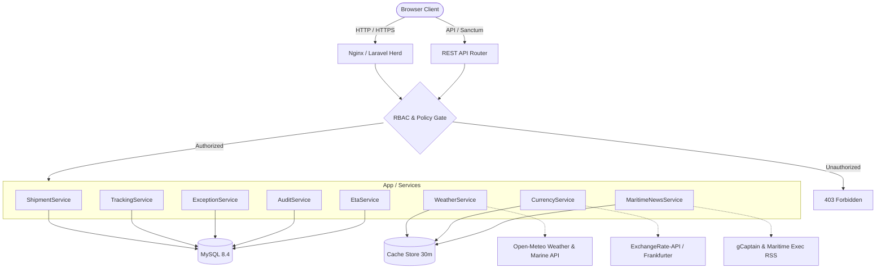
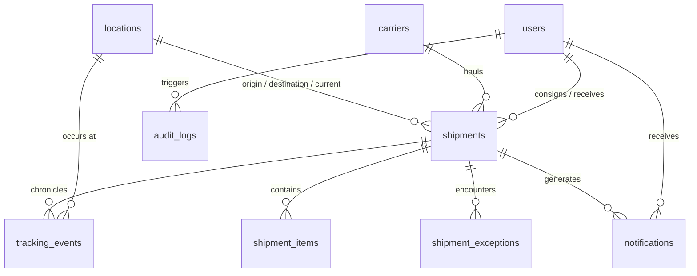

# CargoTrace: Global spice freight by sea, air and road

[](https://laravel.com)
[](https://php.net)
[](https://tailwindcss.com)
[](https://leafletjs.com)
[](https://www.chartjs.org)
[](https://pestphp.com)

> **Academic Capstone Project**  
> Course: Web Programming / Final Individual Project  
> Domain: Global spice freight by sea, air and road (Indonesian spices and essential oils)  
> Local Dev URL: `http://cargotrace.test` (Laravel Herd) or `http://localhost:8000` (Docker)

---

## 1. Quick Links to Project Artifacts
- **[Comprehensive Technical Documentation (EN)](docs/TECHNICAL_DOCUMENTATION.md)**: Full architecture breakdown, 10-table data dictionary, Mermaid ERD with cardinalities, deterministic delay engine specifications, and scenario walkthroughs.
- **[UI Architecture & Design Notes (EN)](docs/ui-notes.md)**: Design system tokens, dual-theme implementation, responsive sidebar navigation, and client-side module reference.
- **[Postman API Collection v2.1](docs/CargoTrace.postman_collection.json)**: Complete Sanctum REST API collection covering authentication, waybill lifecycle, tracking checkpoints, operational exceptions, master data, and external telemetry with pre-request token scripts.
- **[Continuous Integration Workflow](.github/workflows/ci.yml)**: Automated GitHub Actions pipeline verifying migrations, asset compilation, and Pest test suite execution.

---

## 2. Problem Statement & System Overview

Exporting Indonesian spices and essential oils worldwide spans ocean container lines, air cargo freighters, and regional road hauliers, yet shipment visibility remains fragmented across heterogeneous carrier portals and handover hubs. Shippers face critical visibility barriers:
- **Blind Transits & Unannounced Schedule Deviations:** Weather events, customs inspections, flight offloads, and border queues cause unannounced delays without automated customer notifications.
- **Cross-Border Multi-Currency Friction:** Consignments are invoiced in divergent currencies (USD, EUR, INR, IDR), hindering consolidated portfolio valuation.
- **Multi-Tenant Data Privacy:** Consignees require full operational visibility into their consignments without accessing proprietary pricing or trade lanes of competing shippers.

**CargoTrace** solves these problems with a multimodal freight visibility platform featuring:
- **Multimodal Spice Freight Domain:** Tracks sea containers (ISO 6346 & B/L across UN/LOCODE seaports), air cargo (11-digit mod-7 AWB across IATA airports), and road haulage (vehicle plate & CMR across depots and borders) for nutmeg, cloves, cinnamon, pepper, ginger, and patchouli oil.
- **Per-Mode Deterministic Delay & ETA Engine:** Rigorous, reproducible schedule variance calculation (AIR 3h/12h, ROAD 6h/24h, SEA 12h/48h) with automated customer alerts.
- **Dual-Theme Enterprise UI (Light & Dark Mode):** Zero-flicker CSS custom property engine with dynamic OpenStreetMap tile filter synchronization.
- **Responsive Grouped Sidebar:** Grouped operations, intelligence (Location Weather, Currency FX, Freight News), master data, and administration navigation with an icon rail collapse mode (`w-20` / `w-64`).
- **Multi-Tenant Role-Based Access Control (RBAC):** Distinct permission boundaries and automated query scoping for `admin`, `operator`, and `customer` personas.
- **Truthful Telemetry Provenance:** Explicit provenance badges (`LIVE`, `CACHED`, or `SIMULATED`) and context-only external feeds (`context only, not a delay prediction`).

---

## 3. System Architecture & Entity Relationships

### Architecture Topology


### Entity Relationship Diagram (Summary)

*(For complete ERD details and data dictionary for all 10 tables, refer to [Technical Documentation](docs/TECHNICAL_DOCUMENTATION.md)).*

---

## 4. Technology Stack & Keyless External Integrations

| Layer | Technology | Purpose |
|---|---|---|
| **Backend Framework** | Laravel 13.x (PHP 8.3+) | Full-stack MVC architecture, Service layer, Sanctum API auth, Pest tests |
| **Database** | MySQL 8.4 (InnoDB) / SQLite (in-memory tests) | Relational persistence, transactional data integrity |
| **Frontend Styling** | Tailwind CSS v4 via `@tailwindcss/vite` | Semantic CSS custom property dual-theme engine (`data-theme="dark"` / `light`) |
| **Geospatial Mapping** | Leaflet.js v1.9.4 | OpenStreetMap tiles (`tile.openstreetmap.org`) with custom dark inversion CSS filters |
| **3D Route Globe** | Globe.gl / Three.js | WebGL interactive 3D global container trade lane visualization with local textures |
| **Data Analytics** | Chart.js v4.4 | Responsive container lifecycle doughnut, carrier volume, and 30-day FX trend charts |
| **Typography** | Inter & JetBrains Mono | High-legibility sans-serif and tabular monospace fonts bundled via Vite |

### Keyless External Services & Attributions

All live third-party services in CargoTrace operate keyless without requiring API tokens or private registrations:

1. **Open-Meteo API**:
   - **Endpoints**: `https://api.open-meteo.com/v1/forecast` and `https://marine-api.open-meteo.com/v1/marine`
   - **Coverage**: Atmospheric temperature, wind speed, rainfall, relative humidity, and visibility across ports, airports, and depots; oceanic wave height, wave period, wave direction, and swell height for seaports only (context only, not a delay prediction).
   - **Terms & Attribution**: Free for non-commercial and commercial use with attribution. Licensed under [Creative Commons Attribution 4.0 International (CC BY 4.0)](https://open-meteo.com).
2. **ExchangeRate-API**:
   - **Endpoint**: `https://open.er-api.com/v6/latest/USD`
   - **Coverage**: Spot exchange rates for ~160 sovereign currencies, defaulting to USD, EUR, INR, and IDR.
   - **Terms & Attribution**: Free tier with required attribution link to [ExchangeRate-API](https://www.exchangerate-api.com).
3. **Frankfurter API**:
   - **Endpoint**: `https://api.frankfurter.dev/v1/`
   - **Coverage**: European Central Bank official reference exchange rates and 30-day historical time-series data.
   - **Terms & Attribution**: Open source, keyless, and free.
4. **OpenStreetMap & Nominatim**:
   - **Endpoints**: `https://tile.openstreetmap.org/{z}/{x}/{y}.png` and `https://nominatim.openstreetmap.org`
   - **Coverage**: Location geographic coordinates, tile rendering, and reverse geocoding.
   - **Terms & Attribution**: Data &copy; [OpenStreetMap contributors](https://www.openstreetmap.org/copyright) licensed under the Open Database License (ODbL).
5. **Multimodal Freight News RSS Syndication**:
   - **Sea Feeds**: *gCaptain*, *The Maritime Executive*, *Splash247*, *World Cargo News*, *Container News*, *Seatrade Maritime*, and *Hellenic Shipping News*.
   - **Air Feeds**: *Air Cargo News* and *Air Cargo Week*.
   - **Road & Logistics Feeds**: *FreightWaves*, *Transport Topics*, *Commercial Carrier Journal*, and *Supply Chain Dive*.
   - **Terms & Attribution**: Real-time RSS/Atom syndication of headlines, article excerpts, and OpenGraph thumbnails with direct links to full articles on the publishers' websites.
6. **Globe Textures**:
   - Three-Globe NASA Blue Marble, night lights, and Earth topology textures self-hosted locally under `/images/globe/` for zero third-party CDN dependency.

### REST API Endpoints Specification

| Method | URI | Role / Auth | Description | Mode / Parameters |
|---|---|---|---|---|
| `POST` | `/api/register` | Public | Register customer account | Body: name, email, password, company_name, preferred_currency |
| `POST` | `/api/login` | Public | Sanctum token authentication | Body: email, password |
| `POST` | `/api/logout` | Sanctum | Revoke current API token | Header: `Bearer <token>` |
| `GET` | `/api/user` | Sanctum | Get authenticated user profile | Returns authenticated user resource |
| `GET` | `/api/shipments` | Sanctum | List shipments (scoped by customer) | Query: `?mode=SEA\|AIR\|ROAD`, `?status=`, `?carrier_id=`, `?is_delayed=`, `?search=` |
| `POST` | `/api/shipments` | Admin, Operator | Create shipment with cargo items | Mode-specific: SEA requires container_number; AIR requires awb_number; ROAD requires vehicle_plate & cmr_number |
| `GET` | `/api/shipments/{id}` | Sanctum | Show shipment details & events | Scoped to customer owner, admin or operator |
| `PUT/PATCH` | `/api/shipments/{id}` | Admin, Operator | Update shipment status, ETA or notes | Validates status progression, recalculates ETA delay variance |
| `DELETE` | `/api/shipments/{id}` | Admin | Delete shipment record | Hard deletion with cascade to items & events |
| `GET` | `/api/shipments/{id}/tracking` | Sanctum | Chronological tracking timeline | List milestone tracking checkpoints |
| `POST` | `/api/shipments/{id}/tracking` | Admin, Operator | Record new tracking checkpoint | Captures status, location, notes, and weather snapshot |
| `GET` | `/api/shipments/{id}/exceptions` | Sanctum | List shipment exceptions | Open and resolved operational incidents |
| `POST` | `/api/shipments/{id}/exceptions` | Admin, Operator | Report shipment exception | Validates code vs mode (FLIGHT_OFFLOAD for AIR, BORDER_QUEUE/VEHICLE_BREAKDOWN for ROAD, PORT_CONGESTION universal) |
| `PATCH` | `/api/exceptions/{id}` | Admin, Operator | Resolve or update exception status | Transitions OPEN &rarr; INVESTIGATING &rarr; RESOLVED |
| `GET` | `/api/carriers` | Sanctum | Master carrier directory | Filterable by active status and transport mode |
| `POST` | `/api/carriers` | Admin | Register new carrier | Body: code, name, mode (SEA, AIR, ROAD, LAND, MULTIMODAL) |
| `GET` | `/api/locations` | Sanctum | Master location directory | UN/LOCODE, IATA, type (SEAPORT, AIRPORT, DEPOT, BORDER) |
| `POST` | `/api/locations` | Admin | Register location checkpoint | Body: unlocode, iata_code, name, city, country, type |
| `GET` | `/api/integrations/weather` | Sanctum | Live Open-Meteo marine telemetry | Coordinates or port UN/LOCODE |
| `GET` | `/api/integrations/currency` | Sanctum | Spot FX rates (ExchangeRate-API) | Base USD spot rate snapshot |
| `GET` | `/api/integrations/news` | Sanctum | Maritime logistics RSS news feeds | Filterable by feed source |

---

## 5. Installation & Setup

### Option A: Local Development (Laravel Herd / CLI)

#### Prerequisites
- PHP 8.3 or higher with extensions: `pdo`, `pdo_mysql`, `curl`, `mbstring`, `openssl`, `bcmath`, `intl`
- Composer 2.x
- Node.js 20+ & npm
- MySQL 8.0+ running on `127.0.0.1:3306`

#### Setup Steps
```bash
# 1. Clone repository
git clone https://github.com/your-username/cargotrace.git
cd cargotrace

# 2. Install backend dependencies
composer install

# 3. Environment configuration
cp .env.example .env
php artisan key:generate

# 4. Database configuration (configure your DB credentials in .env)
# DB_CONNECTION=mysql
# DB_HOST=127.0.0.1
# DB_PORT=3306
# DB_DATABASE=cargotrace
# DB_USERNAME=root
# DB_PASSWORD=

# 5. Execute migrations and seed maritime data
php artisan migrate --seed

# 6. Install frontend packages and build assets
npm install
npm run build

# 7. Start local development server (if not using Laravel Herd)
php artisan serve
```

---

### Option B: Docker Containerized Setup

CargoTrace includes a production-ready `Dockerfile` and `docker-compose.yml` defining the application server and MySQL 8.4 service:

```bash
# 1. Build and start containers in the background
docker compose up -d --build

# 2. Run migrations and seed data inside the container
docker compose exec app php artisan migrate --seed

# 3. Access application
# Web App: http://localhost:8000
# Database: localhost:3306 (user: cargotrace / password: secret_password)
```

---

## 6. Demo Accounts, Credentials & Sample Shipments

The database seeder provisions pre-configured personas with default password: `password` (see `docs/DEMO_DATA.md` for all 8 accounts, including 4 additional fictional spice wholesalers and fragrance houses).

| Role | Email | Company Affiliation | Access Scope |
|---|---|---|---|
| **Admin** | `admin@cargotrace.test` | Nusa Spice Freight HQ | Universal Control, User Directory, Delay Thresholds, Audit Logs |
| **Operator** | `operator@cargotrace.test` | Nusa Spice Freight Operations Desk | Waybills, Checkpoints, Exceptions Resolution, Master Data |
| **Customer** | `customer@cargotrace.test` | PT Rempah Nusantara Sejahtera | Consigned Shipments & In-App Notifications |
| **Customer 2** | `customer2@cargotrace.test` | Van der Berg Spice Trading B.V. | Consigned Shipments & In-App Notifications |

### Sample Tracking Numbers (Public `/track/{tracking_number}` & Portal)

| Tracking Number | Mode | Route | Status | Cargo Highlights |
|---|---|---|---|---|
| `CTG-SEA-2026-00189` | SEA | `IDJKT` to `NLRTM` | `DELIVERED` (late +10h, LOW) | Whole Nutmeg ABCD & Whole Cloves Lal Pari |
| `CTG-SEA-2026-00244` | SEA | `IDBLW` to `USNYC` | `IN_TRANSIT` (delayed +56h, HIGH) | Sumatra Cassia Cinnamon & Lampung Black Pepper |
| `CTG-AIR-2026-00678` | AIR | `IDKNO` to `FRCDG` | `IN_TRANSIT` (delayed +2.5h, LOW) | Aceh Steam-Distilled Patchouli Essential Oil |

> **Pro-Tip:** The `/login` page features 1-click Quick Demo buttons to authenticate instantly as any role.

---

## 7. Automated Test Suite

The entire application is verified using **Pest PHP** against an isolated in-memory SQLite database, guaranteeing zero side-effects on local MySQL development data.

```bash
# Run complete test suite (174 tests, 1,695 assertions)
php artisan test

# Run feature-specific test suites
php artisan test --filter=WeatherServiceTest
php artisan test --filter=CurrencyServiceTest
php artisan test --filter=MaritimeNewsTest
php artisan test --filter=CustomerScopeTest
php artisan test --filter=DelayThresholdSettingsTest
php artisan test --filter=AdminUserManagementTest
php artisan test --filter=ShipmentCsvExportTest
php artisan test --filter=ShipmentCsvImportTest
php artisan test --filter=DeploymentAndSecurityTest
```

**Verification Results:**
- **174 passed tests** (100% green)
- **1,695 assertions** validating authorization policies, customer query scoping, status transitions, Open-Meteo marine wave height, currency combobox validation, RSS pool parsing, container number ISO 6346 validation, and delay recalculations. Full report: **[docs/TEST_REPORT.md](docs/TEST_REPORT.md)**.

---

## 8. Anti-Slop Design Principles Adherence

This project strictly adheres to the Anti-Slop design guidelines (`.claude/skills/anti-slop/antislop.md`):
- **Truthful Copy & Accurate Terminology:** Completely purged fraudulent claims of "AIS satellite tracking", "Live Telemetry", and "AI Route Planning". All nautical distances are computed via the Great-Circle Haversine formula, exception rates are calculated from active database records, and STS crane advisories are explicitly marked as "Rule-based advisories".
- **Dual-Theme Synchronicity:** Clean light mode (`#F1F5F9` surfaces with `#0F172A` headings) and abyssal dark mode (`#050811`) synchronized with OpenStreetMap tiles.
- **Authentic Visualizations:** Replaced synthetic bunker fuel indices with real, role-scoped portfolio value breakdowns by currency.
- **Strict Role Isolation:** Every customer query is bounded by multi-tenant security guarantees.

---

## 9. Known Limitations

1. **No Live Satellite AIS or Flight Radar Feeds:** CargoTrace chronicles shipment positions and transit progress through registered port, airport, and depot milestones, operator-verified checkpoints, and mathematical great-circle spherical calculations.
2. **Marine Wave Data Coverage:** Open-Meteo Marine API is queried for seaports only and provides wave and swell observations for oceanic and coastal coordinates; airports and inland depots display temperature, wind, rainfall, and visibility only.
3. **Historical FX Time-Series Coverage:** 30-day historical currency charts rely on European Central Bank (Frankfurter) reference currencies. Rare non-ECB sovereign pairs preserve real-time spot conversions while gracefully omitting the historical trendline.
4. **Nominatim Geocoding Rate Limits:** Reverse geocoding via OpenStreetMap Nominatim is strictly rate-limited to 1 request/second and cached persistently in the database.
5. **Single Primary Transport Mode per Shipment:** Phase 1 models one primary mode (SEA, AIR, or ROAD) per shipment; multi-leg door-to-door chaining is future work.

---

## 10. Future Work

1. **EDIFACT & DCSA Maritime Standards:** Native parser for UN/EDIFACT maritime messages (IFTMIN booking instructions, IFTSTA status reports) and DCSA OpenAPI Track & Trace 2.0 specifications.
2. **Commercial Terrestrial & Satellite AIS Feeds:** Integration with maritime transponder providers (Spire, MarineTraffic, VesselFinder) for high-frequency mid-ocean GPS coordinates.
3. **Reefer Container IoT Telemetry:** Direct sensor logging for cold-chain refrigerated containers (internal temperature, relative humidity, power supply state, door-open alerts).
4. **Single-Window Customs Clearance API:** Electronic customs filing integrations (US CBP ACE, EU ICS2, UK CDS) for automated import hold clearance.
5. **Predictive Lane Congestion Engine:** Machine learning model blending historical port dwell times, berth waiting queues, seasonal monsoon patterns, and carrier reliability indexes.

---

## 11. Attribution, Credits & Academic Disclosure

- **Academic Integrity Statement:** This platform was developed as an individual university final project for Web Programming.
- **Anti-Slop Design Community:** Built strictly following the design ethos and delivery gates of the open-source **Anti-Slop Guidelines** (`.claude/skills/anti-slop/antislop.md`) for dignified typography, zero synthetic marketing claims, dual-theme parity, and accessible contrast.
- **Cinematic Maritime Photography:**
  - *Dark Theme Hero & Login Panel:* Container terminal gantry cranes at dusk (`public/images/backgrounds/bg-dark.webp`), photography courtesy of Unsplash under the Unsplash License (free to use for commercial and non-commercial purposes).
  - *Light Theme Hero Panel:* Daytime container vessel berthing (`public/images/backgrounds/hero-light.webp`), royalty-free maritime photography from Unsplash.
- **Design & Layout Inspirations:**
  - *Axis Logistics / CargoWise TMS:* Operational density, monospace bill of lading formatting, and split-screen milestone tracking.
  - *GlobalLink Maritime:* Visual hierarchy for waypoint progression and UN/LOCODE seaport labeling.
- **Third-Party Services & Open Data:**
  - **Open-Meteo & Marine API:** Atmospheric and oceanic wave metrics licensed under [CC BY 4.0](https://open-meteo.com).
  - **OpenStreetMap & Nominatim:** Geographic map tiles and geocoding &copy; [OpenStreetMap contributors](https://www.openstreetmap.org/copyright) under ODbL.
  - **ExchangeRate-API & Frankfurter:** Multi-currency spot rates and ECB historical time-series data.
  - **Freight RSS News Feeds:** Syndicated industry editorial excerpts across sea, air, and road courtesy of *gCaptain*, *The Maritime Executive*, *Splash247*, *World Cargo News*, *Container News*, *Seatrade Maritime*, *Hellenic Shipping News*, *Air Cargo News*, *Air Cargo Week*, *FreightWaves*, *Transport Topics*, *Commercial Carrier Journal*, and *Supply Chain Dive*.
- **AI Tool Assistance:** Generative AI tools (Claude Code / Antigravity) were used in a pair-programming capacity for boilerplate scaffolding, unit test suites, and documentation refinement under developer direction and rigorous verification.

---

&copy; 2026 CargoTrace &bull; Global spice freight by sea, air and road
