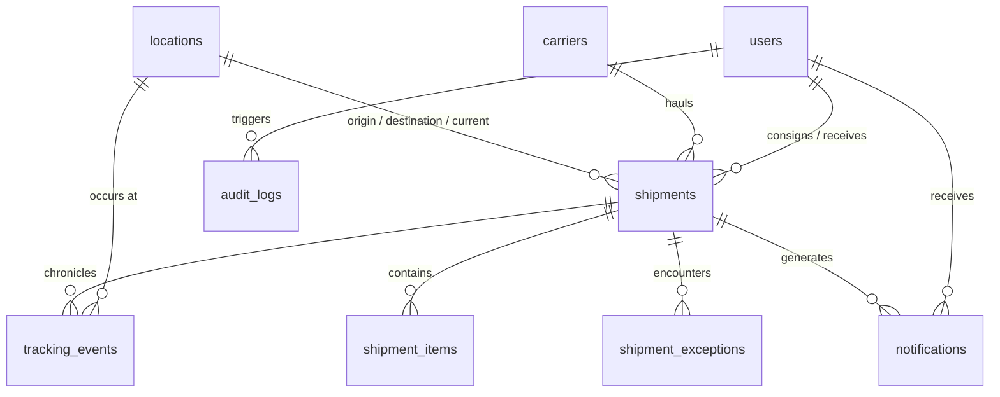

# CargoTrace: Global Ocean Container Shipment Visibility & Tracking Platform

[](https://laravel.com)
[](https://php.net)
[](https://tailwindcss.com)
[](https://leafletjs.com)
[](https://www.chartjs.org)
[-10B981?style=flat)](https://pestphp.com)

> **Academic Capstone Project**  
> Course: Web Programming / Final Individual Project  
> Domain: Enterprise Ocean Container Shipping & Maritime Logistics Visibility  
> Local Dev URL: `http://cargotrace.test` (Laravel Herd) or `http://localhost:8000` (Docker)

---

## 1. Quick Links to Project Artifacts
- **[Comprehensive Technical Documentation (EN)](docs/TECHNICAL_DOCUMENTATION.md)**: Full architecture breakdown, 10-table data dictionary, Mermaid ERD with cardinalities, deterministic delay engine specifications, and scenario walkthroughs.
- **[UI Architecture & Design Notes (EN)](docs/ui-notes.md)**: Design system tokens, dual-theme implementation, responsive sidebar navigation, and client-side module reference.
- **[Postman API Collection v2.1](docs/CargoTrace.postman_collection.json)**: Complete Sanctum REST API collection covering authentication, waybill lifecycle, tracking checkpoints, operational exceptions, master data, and external telemetry with pre-request token scripts.
- **[Continuous Integration Workflow](.github/workflows/ci.yml)**: Automated GitHub Actions pipeline verifying migrations, asset compilation, and Pest test suite execution.

---

## 2. Problem Statement & System Overview

International ocean container shipping powers global commerce, yet container visibility remains fragmented across heterogeneous carrier portals and transshipment hubs. Shippers face critical visibility barriers:
- **Blind Transits & Unannounced Schedule Deviations:** Adverse oceanic weather and seaport terminal congestion cause unannounced delays without automated customer notifications.
- **Cross-Border Multi-Currency Friction:** Bills of lading and manifests are billed in divergent sovereign currencies (EUR, GBP, SGD, CNY), hindering consolidated portfolio valuation.
- **Multi-Tenant Data Privacy:** Consignees require full operational visibility into their containers without accessing proprietary pricing or trade lanes of competing shippers.

**CargoTrace** solves these problems with an enterprise-grade maritime visibility platform featuring:
- **Pure Maritime Domain:** 100% focused on ocean container carriers (Maersk, MSC, CMA CGM, COSCO, Hapag-Lloyd, ONE) and verified UN/LOCODE container seaports.
- **Deterministic Delay & ETA Engine:** Rigorous, reproducible schedule variance calculation ($LOW \le 6\text{h}$, $MEDIUM \le 24\text{h}$, $HIGH > 24\text{h}$) with automated customer alerts.
- **Dual-Theme Enterprise UI (Light & Dark Mode):** Zero-flicker CSS custom property engine with dynamic OpenStreetMap tile filter synchronization.
- **Responsive Grouped Sidebar:** Grouped operations, intelligence, master data, and administration navigation with an icon rail collapse mode (`w-20` / `w-64`).
- **Multi-Tenant Role-Based Access Control (RBAC):** Distinct permission boundaries and automated query scoping for `admin`, `operator`, and `customer` personas.
- **Truthful Telemetry Provenance:** Explicit provenance badges (`LIVE`, `CACHED`, or `SIMULATED`) ensuring academic integrity and operational transparency.

---

## 3. System Architecture & Entity Relationships

### Architecture Topology


### Entity Relationship Diagram (Summary)

*(For complete ERD details and data dictionary for all 10 tables, refer to [Technical Documentation](docs/TECHNICAL_DOCUMENTATION.md)).*

---

## 4. Technology Stack & Keyless External Integrations

| Layer | Technology | Purpose |
|---|---|---|
| **Backend Framework** | Laravel 13.x (PHP 8.3+) | Full-stack MVC architecture, Service layer, Sanctum API auth, Pest tests |
| **Database** | MySQL 8.4 (InnoDB) / SQLite (in-memory tests) | Relational persistence, transactional data integrity |
| **Frontend Styling** | Tailwind CSS v4 via `@tailwindcss/vite` | Semantic CSS custom property dual-theme engine (`data-theme="dark"` / `light`) |
| **Geospatial Mapping** | Leaflet.js v1.9.4 | OpenStreetMap tiles (`tile.openstreetmap.org`) with custom dark inversion CSS filters |
| **3D Route Globe** | Globe.gl / Three.js | WebGL interactive 3D global container trade lane visualization with local textures |
| **Data Analytics** | Chart.js v4.4 | Responsive container lifecycle doughnut, carrier volume, and 30-day FX trend charts |
| **Typography** | Inter & JetBrains Mono | High-legibility sans-serif and tabular monospace fonts bundled via Vite |

### Keyless External Services & Attributions

All live third-party services in CargoTrace operate keyless without requiring API tokens or private registrations:

1. **Open-Meteo API**:
   - **Endpoints**: `https://api.open-meteo.com/v1/forecast` and `https://marine-api.open-meteo.com/v1/marine`
   - **Coverage**: Atmospheric temperature, wind speed, relative humidity, visibility, and oceanic wave height, wave period, wave direction, and swell height.
   - **Terms & Attribution**: Free for non-commercial and commercial use with attribution. Licensed under [Creative Commons Attribution 4.0 International (CC BY 4.0)](https://open-meteo.com).
2. **ExchangeRate-API**:
   - **Endpoint**: `https://open.er-api.com/v6/latest/USD`
   - **Coverage**: Spot exchange rates for ~160 sovereign currencies, updated daily.
   - **Terms & Attribution**: Free tier with required attribution link to [ExchangeRate-API](https://www.exchangerate-api.com).
3. **Frankfurter API**:
   - **Endpoint**: `https://api.frankfurter.dev/v1/`
   - **Coverage**: European Central Bank official reference exchange rates and 30-day historical time-series data.
   - **Terms & Attribution**: Open source, keyless, and free.
4. **OpenStreetMap & Nominatim**:
   - **Endpoints**: `https://tile.openstreetmap.org/{z}/{x}/{y}.png` and `https://nominatim.openstreetmap.org`
   - **Coverage**: Seaport geographic coordinates, tile rendering, and reverse geocoding.
   - **Terms & Attribution**: Data &copy; [OpenStreetMap contributors](https://www.openstreetmap.org/copyright) licensed under the Open Database License (ODbL).
5. **Maritime News RSS Syndication**:
   - **Feeds**: *gCaptain* (`https://gcaptain.com/feed/`) and *The Maritime Executive* (`https://maritime-executive.com/rss`).
   - **Terms & Attribution**: Real-time RSS syndication of headlines, article excerpts, and OpenGraph thumbnails with direct links to full articles on the publishers' websites.
6. **Globe Textures**:
   - Three-Globe NASA Blue Marble, night lights, and Earth topology textures self-hosted locally under `/images/globe/` for zero third-party CDN dependency.

---

## 5. Installation & Setup

### Option A: Local Development (Laravel Herd / CLI)

#### Prerequisites
- PHP 8.3 or higher with extensions: `pdo`, `pdo_mysql`, `curl`, `mbstring`, `openssl`, `bcmath`, `intl`
- Composer 2.x
- Node.js 20+ & npm
- MySQL 8.0+ running on `127.0.0.1:3306`

#### Setup Steps
```bash
# 1. Clone repository
git clone https://github.com/your-username/cargotrace.git
cd cargotrace

# 2. Install backend dependencies
composer install

# 3. Environment configuration
cp .env.example .env
php artisan key:generate

# 4. Database configuration (configure your DB credentials in .env)
# DB_CONNECTION=mysql
# DB_HOST=127.0.0.1
# DB_PORT=3306
# DB_DATABASE=cargotrace
# DB_USERNAME=root
# DB_PASSWORD=

# 5. Execute migrations and seed maritime data
php artisan migrate --seed

# 6. Install frontend packages and build assets
npm install
npm run build

# 7. Start local development server (if not using Laravel Herd)
php artisan serve
```

---

### Option B: Docker Containerized Setup

CargoTrace includes a production-ready `Dockerfile` and `docker-compose.yml` defining the application server and MySQL 8.4 service:

```bash
# 1. Build and start containers in the background
docker compose up -d --build

# 2. Run migrations and seed data inside the container
docker compose exec app php artisan migrate --seed

# 3. Access application
# Web App: http://localhost:8000
# Database: localhost:3306 (user: cargotrace / password: secret_password)
```

---

## 6. Demo Accounts & Credentials

The database seeder provisions pre-configured personas with default password: `password`.

| Role | Email | Company Affiliation | Access Scope |
|---|---|---|---|
| **Admin** | `admin@cargotrace.test` | CargoTrace HQ Operations | Universal Control, User Directory, Delay Thresholds, Audit Logs |
| **Operator** | `operator@cargotrace.test` | Port Operations Center | Waybills, Checkpoints, Exceptions Resolution, Master Data |
| **Customer** | `customer@cargotrace.test` | PT Nusantara Ocean Cargo | Consigned Shipments & In-App Notifications |
| **Customer 2** | `customer2@cargotrace.test` | EuroPacific Maritime B.V. | Consigned Shipments & In-App Notifications |

> **Pro-Tip:** The `/login` page features 1-click Quick Demo buttons to authenticate instantly as any role.

---

## 7. Automated Test Suite

The entire application is verified using **Pest PHP** against an isolated in-memory SQLite database, guaranteeing zero side-effects on local MySQL development data.

```bash
# Run complete test suite (100 tests, 529 assertions)
php artisan test

# Run feature-specific test suites
php artisan test --filter=WeatherServiceTest
php artisan test --filter=CurrencyServiceTest
php artisan test --filter=MaritimeNewsTest
php artisan test --filter=CustomerScopeTest
php artisan test --filter=DelayThresholdSettingsTest
php artisan test --filter=AdminUserManagementTest
php artisan test --filter=ShipmentCsvExportTest
```

**Verification Results:**
- **100 passed tests** (100% green)
- **529 assertions** validating authorization policies, customer query scoping, status transitions, Open-Meteo marine wave height, currency combobox validation, RSS pool parsing, and delay recalculations.

---

## 8. Anti-Slop Design Principles Adherence

This project strictly adheres to the Anti-Slop design guidelines (`.claude/skills/anti-slop/antislop.md`):
- **Truthful Copy & Accurate Terminology:** Completely purged fraudulent claims of "AIS satellite tracking", "Live Telemetry", and "AI Route Planning". All nautical distances are computed via the Great-Circle Haversine formula, exception rates are calculated from active database records, and STS crane advisories are explicitly marked as "Rule-based advisories".
- **Dual-Theme Synchronicity:** Clean light mode (`#F1F5F9` surfaces with `#0F172A` headings) and abyssal dark mode (`#050811`) synchronized with OpenStreetMap tiles.
- **Authentic Visualizations:** Replaced synthetic bunker fuel indices with real, role-scoped portfolio value breakdowns by currency.
- **Strict Role Isolation:** Every customer query is bounded by multi-tenant security guarantees.

---

## 9. Known Limitations

1. **No Live AIS Transponder Data:** CargoTrace chronicles container vessel positions based on registered seaport milestones and mathematical great-circle trajectory interpolations. It does not ingest live satellite AIS VHF transponder telemetry.
2. **Marine Wave Data Coverage:** Open-Meteo Marine API provides wave and swell metrics for coastal and oceanic coordinates. Inland terminals or river ports display "No marine data for this location".
3. **Frankfurter ECB Coverage:** 30-day historical currency trends depend on European Central Bank reference pairs. Non-ECB sovereign pairs gracefully hide the historical chart while preserving real-time conversion.

---

## 10. Future Work

1. **EDIFACT & DCSA Integration:** Support for standard maritime EDIFACT protocols (IFTMIN, IFTSTA) and DCSA Track & Trace APIs for automated ocean carrier manifest ingestion.
2. **Commercial AIS Satellite Feeds:** Direct integration with commercial maritime AIS providers (e.g. Spire, MarineTraffic) for live ocean vessel transponder positions.
3. **Reefer Container IoT Telemetry:** Direct sensor logging for cold-chain containers (internal temperature, relative humidity, power supply state).
4. **Intermodal Transshipment Routing:** Multi-leg routing support with barge, rail, and port terminal gate in/gate out tracking.

---

## 11. Attribution & AI Usage Disclosure

- **Academic Integrity Statement:** This application was developed as an individual university final project for Web Programming.
- **AI Tool Assistance:** Generative AI tools (Claude Code / Antigravity) were used in a pair-programming capacity for boilerplate scaffolding, test case creation, and documentation refinement under developer direction and rigorous verification.
- **Utility Scripts:** The `scripts/capture-dashboards.js` script leverages Puppeteer Core and headless Chrome to generate multi-viewport automated verification screenshots across roles and themes.

---

&copy; 2026 CargoTrace &bull; Global Ocean Container Shipment Visibility & Tracking Platform
