# CargoTrace: Technical System Documentation & Architecture Specification

**Project Title:** CargoTrace: Global Ocean Container Shipment Visibility & Tracking Platform  
**System Version:** 1.0.0 (Release Candidate)  
**Academic Context:** Individual Capstone Project &bull; Web Programming  
**Author:** Individual Engineering Implementation  
**Runtime Environment:** PHP 8.3+ / Laravel 13.x, MySQL 8.4, Tailwind CSS v4, Vanilla JS ES Modules  

---

## Table of Contents
1. [Executive Overview & System Architecture](#1-executive-overview--system-architecture)
2. [Entity Relationship Diagram (ERD) & Schema Topography](#2-entity-relationship-diagram-erd--schema-topography)
3. [Comprehensive Data Dictionary](#3-comprehensive-data-dictionary)
4. [Deterministic Business Rules & Logic Engines](#4-deterministic-business-rules--logic-engines)
5. [Group Scenario Testing & Evaluation Walkthrough](#5-group-scenario-testing--evaluation-walkthrough)
6. [API Specification & Authentication Lifecycle](#6-api-specification--authentication-lifecycle)
7. [System Boundaries, Limitations & Anti-Slop Adherence](#7-system-boundaries-limitations--anti-slop-adherence)
8. [Third-Party Services & Dependency Attributions](#8-third-party-services--dependency-attributions)

---

## 1. Executive Overview & System Architecture

### 1.1 Architecture Pattern
CargoTrace is architected on an **Enterprise N-Tier Service Layer Pattern** built upon Laravel 13. All core domain logic, external API integrations, currency computations, and audit logging are decoupled from HTTP controllers into dedicated, reusable services in `app/Services/`.

```mermaid
graph TD
    subgraph ClientLayer [Client & Presentation Layer]
        BrowserWeb["Desktop / Mobile Browser (Blade + Tailwind v4 + Vanilla JS)"]
        PostmanClient["REST API Clients (Postman v2.1 / Automated Test Harness)"]
    end

    subgraph HttpRouting [Routing & Middleware Guard]
        WebRouter["routes/web.php (Session Auth + CSRF)"]
        ApiRouter["routes/api.php (Sanctum Bearer Token)"]
        RbacMiddleware["EnsureUserHasRole Middleware (admin, operator, customer)"]
        ThrottleGate["Rate Limiter (throttle:30,1 on Public Tracking)"]
    end

    subgraph ControllerLayer [Controller Layer]
        WebControllers["Web Controllers (Dashboard, Shipments, Exceptions, Admin, etc.)"]
        ApiControllers["Api Controllers (ShipmentApi, TrackingApi, ExceptionApi, MasterApi)"]
        PolicyGate["Laravel Policies (ShipmentPolicy)"]
    end

    subgraph ServiceLayer [Application Service Layer (app/Services)]
        ShipmentSvc["ShipmentService (Waybill CRUD, Status Progression, Terminal Locks)"]
        EtaSvc["EtaService (Deterministic Delay Variance & Severity Categorization)"]
        TrackingSvc["TrackingService (Checkpoint Milestones & Port Weather Snapping)"]
        ExceptionSvc["ExceptionService (Incident Logging, Investigation, Resolution)"]
        ExternalSvc["ExternalIntegrationService (OpenWeather, OpenExchange, NewsData)"]
        AuditSvc["AuditService (Immutable Audit Trail & IP Logging)"]
    end

    subgraph DataCacheLayer [Persistence & Caching Infrastructure]
        AppDb[("MySQL 8.4 Relational Storage (InnoDB Engine)")]
        CacheStore[("Cache Layer (15m Cache for External Telemetry & Settings)")]
    end

    subgraph ExternalGateways [External Telemetry Gateways]
        OpenWeather["OpenWeatherMap API (Port Atmospheric Conditions)"]
        OpenExchange["Open Exchange Rates API (Foreign Currency to USD)"]
        NewsData["NewsData.io API (Maritime Logistics Bulletins)"]
        Nominatim["OpenStreetMap Nominatim (UN/LOCODE Geocoding)"]
    end

    BrowserWeb --> WebRouter
    PostmanClient --> ApiRouter

    WebRouter --> RbacMiddleware --> WebControllers
    ApiRouter --> RbacMiddleware --> ApiControllers

    WebControllers --> PolicyGate
    ApiControllers --> PolicyGate
    PolicyGate --> ServiceLayer

    ShipmentSvc --> AppDb
    ShipmentSvc --> AuditSvc
    ShipmentSvc --> EtaSvc
    ShipmentSvc --> ExternalSvc

    TrackingSvc --> AppDb
    TrackingSvc --> ExternalSvc

    ExceptionSvc --> AppDb
    ExceptionSvc --> AuditSvc

    EtaSvc --> AppDb
    EtaSvc --> CacheStore

    ExternalSvc --> CacheStore
    ExternalSvc -.->|Cache Miss| OpenWeather
    ExternalSvc -.->|Cache Miss| OpenExchange
    ExternalSvc -.->|Cache Miss| NewsData
    ExternalSvc -.->|Cache Miss| Nominatim

    AuditSvc --> AppDb
```

### 1.2 Separation of Concerns Matrix
- **Controllers:** Restricted strictly to HTTP request payload reception, form request delegation, service invocation, and view/resource response rendering. Zero arithmetic or business condition checks are executed inside controllers.
- **Service Layer (`app/Services/`):** Contains 100% of the operational logic:
  - `ShipmentService`: Handles container registration, status progression, terminal status protection, item tallying, and total consignment weight/volume recalculations.
  - `EtaService`: Deterministically evaluates schedule variances, assigns `delay_severity` (`NONE`, `LOW`, `MEDIUM`, `HIGH`), and dispatches in-app notifications.
  - `TrackingService`: Records point-in-time milestones, binds geographic coordinates, and automatically snaps verified atmospheric weather.
  - `ExceptionService`: Tracks maritime anomalies (`PORT_CONGESTION`, `CUSTOMS_HOLD`, `WEATHER_DELAY`, etc.), escalates statuses, and records resolution notes.
  - `ExternalIntegrationService`: Wraps HTTP callouts with a resilient 15-minute caching mechanism and transparent fallback simulation flags.
  - `AuditService`: Persists JSON deltas of model modifications, user identities, and client IP addresses into `audit_logs`.

---

## 2. Entity Relationship Diagram (ERD) & Schema Topography

```mermaid
erDiagram
    users ||--o{ shipments : "consigns / receives as customer"
    users ||--o{ notifications : "receives alerts"
    users ||--o{ audit_logs : "triggers actions"
    users ||--o{ tracking_events : "records milestones"
    users ||--o{ shipment_exceptions : "reports or resolves"

    carriers ||--o{ shipments : "hauls vessel voyage"

    locations ||--o{ shipments : "origin port (origin_location_id)"
    locations ||--o{ shipments : "destination port (destination_location_id)"
    locations ||--o{ shipments : "current port checkpoint (current_location_id)"
    locations ||--o{ tracking_events : "occurs at port facility"

    shipments ||--o{ shipment_items : "contains cargo line items"
    shipments ||--o{ tracking_events : "chronicles checkpoint history"
    shipments ||--o{ shipment_exceptions : "encounters operational disruptions"
    shipments ||--o{ notifications : "generates schedule alerts"

    users {
        bigint id PK
        string name
        string email UK
        string password
        enum role "admin, operator, customer"
        string company_name
        string phone
        string preferred_currency
        boolean is_active
        timestamps created_at_updated_at
    }

    carriers {
        bigint id PK
        string code UK "e.g. MAEU, MSCU, CMDU, COSU"
        string name "e.g. Maersk Line, MSC"
        enum mode "SEA, AIR, LAND, MULTIMODAL"
        string headquarters_country
        string contact_email
        string website
        boolean is_active
        timestamps created_at_updated_at
    }

    locations {
        bigint id PK
        string unlocode UK "e.g. SGSIN, NLRTM, CNSHA"
        string name "e.g. Port of Singapore"
        string city
        string country
        string country_code "ISO 3166-1 alpha-2"
        string currency_code "ISO 4217"
        enum type "PORT, AIRPORT, HUB, WAREHOUSE"
        decimal latitude "Precision 10,7"
        decimal longitude "Precision 10,7"
        string timezone
        json weather_snapshot
        json news_snapshot
        timestamps created_at_updated_at
    }

    shipments {
        bigint id PK
        string tracking_number UK "e.g. CTG-SEA-2026-0001"
        string reference_number "Shipper B/L Reference"
        bigint customer_id FK "References users.id"
        bigint carrier_id FK "References carriers.id"
        bigint origin_location_id FK "References locations.id"
        bigint destination_location_id FK "References locations.id"
        bigint current_location_id FK "References locations.id (Nullable)"
        string cargo_type "e.g. FCL, REEFER, HAZMAT"
        decimal total_weight_kg "Precision 12,2"
        decimal total_volume_cbm "Precision 10,2"
        decimal declared_value "Precision 15,2"
        string currency_code "Origin Currency (3 chars)"
        decimal shipping_cost "Precision 15,2"
        decimal exchange_rate_to_usd "Precision 15,6"
        decimal converted_value_usd "Precision 15,2"
        json currency_snapshot
        enum status "CREATED, BOOKED, PICKED_UP, IN_TRANSIT, DELIVERED"
        datetime expected_departure_at
        datetime expected_arrival_at
        datetime estimated_arrival_at
        datetime actual_arrival_at
        boolean is_delayed
        decimal delay_hours "Precision 8,2"
        enum delay_severity "NONE, LOW, MEDIUM, HIGH"
        string delay_reason
        json route_news_snapshot
        text notes
        timestamps created_at_updated_at
    }

    shipment_items {
        bigint id PK
        bigint shipment_id FK "References shipments.id (Cascade)"
        string sku
        string description
        int quantity
        decimal unit_value "Precision 12,2"
        string currency_code "Precision 3"
        decimal weight_kg "Precision 10,2"
        decimal volume_cbm "Precision 10,2"
        boolean is_hazardous
        timestamps created_at_updated_at
    }

    tracking_events {
        bigint id PK
        bigint shipment_id FK "References shipments.id (Cascade)"
        bigint location_id FK "References locations.id (Null on Delete)"
        enum status "CREATED, BOOKED, PICKED_UP, IN_TRANSIT, DELIVERED"
        enum event_type "NORMAL, EXCEPTION, SYSTEM"
        string title
        text description
        decimal latitude "Precision 10,7"
        decimal longitude "Precision 10,7"
        json weather_snapshot
        datetime occurred_at
        bigint created_by FK "References users.id"
        timestamps created_at_updated_at
    }

    shipment_exceptions {
        bigint id PK
        bigint shipment_id FK "References shipments.id (Cascade)"
        enum exception_code "CUSTOMS_HOLD, WEATHER_DELAY, PORT_CONGESTION, DAMAGED, MISROUTED, DOCUMENTATION_ISSUE"
        enum severity "LOW, MEDIUM, HIGH"
        enum status "OPEN, INVESTIGATING, RESOLVED"
        string title
        text description
        string related_news_url
        text resolution_notes
        datetime detected_at
        datetime resolved_at
        bigint reported_by FK "References users.id"
        bigint resolved_by FK "References users.id"
        timestamps created_at_updated_at
    }

    audit_logs {
        bigint id PK
        bigint user_id FK "References users.id"
        string action "e.g. shipment.created, shipment.updated"
        string auditable_type "Polymorphic Model Class"
        bigint auditable_id "Polymorphic Record ID"
        json old_values
        json new_values
        string ip_address
        timestamp created_at
    }

    settings {
        bigint id PK
        string key UK "e.g. delay_low_threshold_hours"
        text value
        timestamps created_at_updated_at
    }

    notifications {
        bigint id PK
        bigint user_id FK "References users.id (Cascade)"
        bigint shipment_id FK "References shipments.id (Null on Delete)"
        string type "e.g. delay.escalated, exception.reported"
        string title
        text message
        datetime read_at
        timestamps created_at_updated_at
    }
```



---

## 3. Comprehensive Data Dictionary

### Table 1: `users`
Primary user repository managing role permissions and customer account credentials.
| Column | Type | Nullable | Default | Constraints / Enum | Purpose & Description |
|---|---|---|---|---|---|
| `id` | `BIGINT UNSIGNED` | No | Auto | Primary Key | Unique user record identifier |
| `name` | `VARCHAR(255)` | No | None | - | Full legal name or representative name |
| `email` | `VARCHAR(255)` | No | None | Unique Index | Login email address |
| `email_verified_at` | `TIMESTAMP` | Yes | `NULL` | - | Timestamp when email verification occurred |
| `password` | `VARCHAR(255)` | No | None | - | Bcrypt-hashed authentication password |
| `role` | `ENUM` | No | `'customer'` | `'admin', 'operator', 'customer'` | RBAC permission classification |
| `company_name` | `VARCHAR(255)` | Yes | `NULL` | - | Corporate shipping / logistics firm name |
| `phone` | `VARCHAR(50)` | Yes | `NULL` | - | Operational emergency contact phone number |
| `preferred_currency` | `CHAR(3)` | No | `'USD'` | ISO 4217 | Preferred display currency for analytics |
| `is_active` | `TINYINT(1)` | No | `1` | Index | System active status toggle |
| `remember_token` | `VARCHAR(100)` | Yes | `NULL` | - | Web session remember token |
| `created_at` | `TIMESTAMP` | Yes | `NULL` | - | Creation timestamp |
| `updated_at` | `TIMESTAMP` | Yes | `NULL` | - | Modification timestamp |

---

### Table 2: `carriers`
Directory of verified ocean shipping lines.
| Column | Type | Nullable | Default | Constraints / Enum | Purpose & Description |
|---|---|---|---|---|---|
| `id` | `BIGINT UNSIGNED` | No | Auto | Primary Key | Carrier identifier |
| `code` | `VARCHAR(20)` | No | None | Unique Index | Carrier call sign / prefix (e.g., `MAEU`, `MSCU`) |
| `name` | `VARCHAR(255)` | No | None | - | Commercial entity name (e.g., Maersk Line) |
| `mode` | `ENUM` | No | None | `'SEA', 'AIR', 'LAND', 'MULTIMODAL'` | Transport mode (`SEA` strictly enforced) |
| `headquarters_country`| `VARCHAR(100)` | Yes | `NULL` | - | Domiciled sovereign country |
| `contact_email` | `VARCHAR(255)` | Yes | `NULL` | Email | Central operations dispatch email |
| `website` | `VARCHAR(255)` | Yes | `NULL` | URL | Official public corporate web portal |
| `is_active` | `TINYINT(1)` | No | `1` | Index | Active carrier status |
| `created_at` | `TIMESTAMP` | Yes | `NULL` | - | Record timestamp |
| `updated_at` | `TIMESTAMP` | Yes | `NULL` | - | Record timestamp |

---

### Table 3: `locations`
Standardized container terminal seaport directory index.
| Column | Type | Nullable | Default | Constraints / Enum | Purpose & Description |
|---|---|---|---|---|---|
| `id` | `BIGINT UNSIGNED` | No | Auto | Primary Key | Unique location identifier |
| `unlocode` | `VARCHAR(10)` | No | None | Unique Index | UN/LOCODE (e.g., `SGSIN`, `NLRTM`, `CNSHA`) |
| `name` | `VARCHAR(255)` | No | None | - | Port / Terminal name |
| `city` | `VARCHAR(100)` | No | None | - | Municipal locality |
| `country` | `VARCHAR(100)` | No | None | - | Sovereign state name |
| `country_code` | `CHAR(2)` | No | None | ISO 3166-1 | Two-letter country code |
| `currency_code` | `CHAR(3)` | No | None | ISO 4217 | Sovereign billing currency code |
| `type` | `ENUM` | No | `'PORT'` | `'PORT', 'AIRPORT', 'HUB', 'WAREHOUSE'` | Facility categorization |
| `latitude` | `DECIMAL(10,7)`| No | None | - | Latitude coordinate |
| `longitude` | `DECIMAL(10,7)`| No | None | - | Longitude coordinate |
| `timezone` | `VARCHAR(100)` | No | None | - | IANA standard timezone identifier |
| `weather_snapshot` | `JSON` | Yes | `NULL` | - | Cached OpenWeather observation |
| `news_snapshot` | `JSON` | Yes | `NULL` | - | Cached port traffic / strike news dispatch |
| `created_at` | `TIMESTAMP` | Yes | `NULL` | - | Record creation timestamp |
| `updated_at` | `TIMESTAMP` | Yes | `NULL` | - | Record update timestamp |

---

### Table 4: `shipments`
Central maritime waybill record tracking cargo journeys from origin to destination.
| Column | Type | Nullable | Default | Constraints / Enum | Purpose & Description |
|---|---|---|---|---|---|
| `id` | `BIGINT UNSIGNED` | No | Auto | Primary Key | Waybill record ID |
| `tracking_number` | `VARCHAR(50)` | No | None | Unique Index | Standardized tracking number (`CTG-SEA-...`) |
| `reference_number`| `VARCHAR(100)` | Yes | `NULL` | Index | Commercial Bill of Lading / Customer reference |
| `customer_id` | `BIGINT UNSIGNED` | No | None | Foreign Key (`users.id`) | Consignee customer user |
| `carrier_id` | `BIGINT UNSIGNED` | No | None | Foreign Key (`carriers.id`) | Assigned container ocean carrier |
| `origin_location_id` | `BIGINT UNSIGNED` | No | None | Foreign Key (`locations.id`)| Origin loading seaport |
| `destination_location_id`| `BIGINT UNSIGNED` | No | None | Foreign Key (`locations.id`)| Final port of discharge |
| `current_location_id` | `BIGINT UNSIGNED`| Yes | `NULL` | Foreign Key (`locations.id`)| Current checkpoint seaport |
| `cargo_type` | `VARCHAR(50)` | No | None | - | Cargo form: `FCL`, `LCL`, `REEFER`, `HAZMAT` |
| `total_weight_kg` | `DECIMAL(12,2)` | No | `0.00` | - | Consolidated manifest weight in kg |
| `total_volume_cbm`| `DECIMAL(10,2)` | No | `0.00` | - | Consolidated cubic meters volume |
| `declared_value` | `DECIMAL(15,2)` | No | `0.00` | - | Declared valuation in origin currency |
| `currency_code` | `CHAR(3)` | No | `'USD'` | ISO 4217 | Declared cargo valuation currency |
| `shipping_cost` | `DECIMAL(15,2)` | No | `0.00` | - | Contracted freight fee |
| `exchange_rate_to_usd`| `DECIMAL(15,6)`| No | `1.000000` | - | Conversion multiplier to USD base |
| `converted_value_usd`| `DECIMAL(15,2)` | No | `0.00` | - | Normalized valuation in base currency USD |
| `currency_snapshot` | `JSON` | Yes | `NULL` | - | Snapshot of FX rates at booking time |
| `status` | `ENUM` | No | `'CREATED'` | `'CREATED', 'BOOKED', 'PICKED_UP', 'IN_TRANSIT', 'DELIVERED'` | Finite state machine lifecycle stage |
| `expected_departure_at`| `DATETIME` | No | None | - | Scheduled departure from origin |
| `expected_arrival_at` | `DATETIME` | No | None | - | Original contractual baseline arrival |
| `estimated_arrival_at`| `DATETIME` | Yes | `NULL` | - | Revised dynamic estimated arrival time (ETA) |
| `actual_arrival_at` | `DATETIME` | Yes | `NULL` | - | Actual verified gate-in arrival timestamp |
| `is_delayed` | `TINYINT(1)` | No | `0` | Index | Boolean flag indicating schedule delay |
| `delay_hours` | `DECIMAL(8,2)` | No | `0.00` | - | Numeric variance in hours (`ETA - Expected`) |
| `delay_severity` | `ENUM` | No | `'NONE'` | `'NONE', 'LOW', 'MEDIUM', 'HIGH'` | Rule-based delay severity categorization |
| `delay_reason` | `VARCHAR(255)` | Yes | `NULL` | - | Operator-supplied explanation for variance |
| `route_news_snapshot` | `JSON` | Yes | `NULL` | - | Related news articles affecting corridor |
| `notes` | `TEXT` | Yes | `NULL` | - | Internal handling notes / manifests |
| `created_at` | `TIMESTAMP` | Yes | `NULL` | - | Record creation timestamp |
| `updated_at` | `TIMESTAMP` | Yes | `NULL` | - | Record modification timestamp |

---

### Table 5: `shipment_items`
Detailed line-item cargo inventory enclosed inside the ocean container.
| Column | Type | Nullable | Default | Constraints / Enum | Purpose & Description |
|---|---|---|---|---|---|
| `id` | `BIGINT UNSIGNED` | No | Auto | Primary Key | Item identifier |
| `shipment_id` | `BIGINT UNSIGNED` | No | None | Foreign Key (`shipments.id` on delete cascade) | Parent shipment waybill |
| `sku` | `VARCHAR(100)` | No | None | Index | Stock Keeping Unit / Part number |
| `description` | `VARCHAR(255)` | No | None | - | Description of commodity |
| `quantity` | `INT` | No | None | Minimum 1 | Unit count packed |
| `unit_value` | `DECIMAL(12,2)` | No | `0.00` | - | Commercial value per item unit |
| `currency_code` | `CHAR(3)` | No | `'USD'` | ISO 4217 | Currency of item valuation |
| `weight_kg` | `DECIMAL(10,2)` | No | None | - | Total item weight in kg |
| `volume_cbm` | `DECIMAL(10,2)` | No | None | - | Total item volume in cubic meters |
| `is_hazardous` | `TINYINT(1)` | No | `0` | - | Hazardous goods / IMO class indicator |
| `created_at` | `TIMESTAMP` | Yes | `NULL` | - | Record timestamp |
| `updated_at` | `TIMESTAMP` | Yes | `NULL` | - | Record timestamp |

---

### Table 6: `tracking_events`
Chronological milestone audit trail recording movements and checkpoints.
| Column | Type | Nullable | Default | Constraints / Enum | Purpose & Description |
|---|---|---|---|---|---|
| `id` | `BIGINT UNSIGNED` | No | Auto | Primary Key | Milestone record identifier |
| `shipment_id` | `BIGINT UNSIGNED` | No | None | Foreign Key (`shipments.id` on delete cascade) | Associated shipment |
| `location_id` | `BIGINT UNSIGNED` | Yes | `NULL` | Foreign Key (`locations.id` on delete set null) | Port location where checkpoint occurred |
| `status` | `ENUM` | No | None | Same as `shipments.status` | Associated lifecycle state at milestone |
| `event_type` | `ENUM` | No | `'NORMAL'` | `'NORMAL', 'EXCEPTION', 'SYSTEM'` | Classification of checkpoint |
| `title` | `VARCHAR(255)` | No | None | - | Concise event title (e.g. Vessel Departed) |
| `description` | `TEXT` | Yes | `NULL` | - | Detailed checkpoint observations |
| `latitude` | `DECIMAL(10,7)`| Yes | `NULL` | - | Event geographic latitude coordinate |
| `longitude` | `DECIMAL(10,7)`| Yes | `NULL` | - | Event geographic longitude coordinate |
| `weather_snapshot` | `JSON` | Yes | `NULL` | - | Point-in-time OpenWeather atmospheric telemetry |
| `occurred_at` | `DATETIME` | No | None | Index | Actual physical occurrence time |
| `created_by` | `BIGINT UNSIGNED` | Yes | `NULL` | Foreign Key (`users.id` on delete set null) | Operator who verified and logged event |
| `created_at` | `TIMESTAMP` | Yes | `NULL` | - | Record creation timestamp |
| `updated_at` | `TIMESTAMP` | Yes | `NULL` | - | Record modification timestamp |

---

### Table 7: `shipment_exceptions`
Disruptions, delays, damage, or legal holds logged against a shipment.
| Column | Type | Nullable | Default | Constraints / Enum | Purpose & Description |
|---|---|---|---|---|---|
| `id` | `BIGINT UNSIGNED` | No | Auto | Primary Key | Exception identifier |
| `shipment_id` | `BIGINT UNSIGNED` | No | None | Foreign Key (`shipments.id` on delete cascade) | Targeted shipment |
| `exception_code` | `ENUM` | No | None | `'CUSTOMS_HOLD', 'WEATHER_DELAY', 'PORT_CONGESTION', 'DAMAGED', 'MISROUTED', 'DOCUMENTATION_ISSUE'` | Standardized logistics incident code |
| `severity` | `ENUM` | No | None | `'LOW', 'MEDIUM', 'HIGH'` | Severity classification |
| `status` | `ENUM` | No | `'OPEN'` | `'OPEN', 'INVESTIGATING', 'RESOLVED'` | Lifecycle resolution status |
| `title` | `VARCHAR(255)` | No | None | - | Incident heading |
| `description` | `TEXT` | No | None | - | Detailed incident report |
| `related_news_url`| `VARCHAR(500)` | Yes | `NULL` | URL | External advisory or port authority link |
| `resolution_notes`| `TEXT` | Yes | `NULL` | - | Resolution documentation |
| `detected_at` | `DATETIME` | No | None | - | When incident was detected |
| `resolved_at` | `DATETIME` | Yes | `NULL` | - | When incident was marked resolved |
| `reported_by` | `BIGINT UNSIGNED` | Yes | `NULL` | Foreign Key (`users.id` on delete set null) | Operator logging the incident |
| `resolved_by` | `BIGINT UNSIGNED` | Yes | `NULL` | Foreign Key (`users.id` on delete set null) | Operator resolving the incident |
| `created_at` | `TIMESTAMP` | Yes | `NULL` | - | Record creation timestamp |
| `updated_at` | `TIMESTAMP` | Yes | `NULL` | - | Record modification timestamp |

---

### Table 8: `audit_logs`
Immutable compliance ledger tracking data modifications across the system.
| Column | Type | Nullable | Default | Constraints / Enum | Purpose & Description |
|---|---|---|---|---|---|
| `id` | `BIGINT UNSIGNED` | No | Auto | Primary Key | Audit log identifier |
| `user_id` | `BIGINT UNSIGNED` | Yes | `NULL` | Foreign Key (`users.id` on delete set null) | User who executed the action |
| `action` | `VARCHAR(100)` | No | None | Index | Action key (e.g. `shipment.created`) |
| `auditable_type` | `VARCHAR(255)` | No | None | Index composite | Eloquent Model class (e.g. `App\Models\Shipment`) |
| `auditable_id` | `BIGINT UNSIGNED` | No | None | Index composite | Record ID modified |
| `old_values` | `JSON` | Yes | `NULL` | - | JSON serialized attributes before update |
| `new_values` | `JSON` | Yes | `NULL` | - | JSON serialized attributes after update |
| `ip_address` | `VARCHAR(45)` | Yes | `NULL` | IPv4 / IPv6 | Client IP address originating the request |
| `created_at` | `TIMESTAMP` | Yes | `NULL` | Index | Timestamp action occurred |

---

### Table 9: `settings`
Key-value runtime configuration store for operations managers.
| Column | Type | Nullable | Default | Constraints / Enum | Purpose & Description |
|---|---|---|---|---|---|
| `id` | `BIGINT UNSIGNED` | No | Auto | Primary Key | Setting identifier |
| `key` | `VARCHAR(100)` | No | None | Unique Index | Unique key identifier (e.g. `delay_low_threshold_hours`) |
| `value` | `TEXT` | Yes | `NULL` | - | String-serialized runtime configuration value |
| `created_at` | `TIMESTAMP` | Yes | `NULL` | - | Creation timestamp |
| `updated_at` | `TIMESTAMP` | Yes | `NULL` | - | Last modification timestamp |

---

### Table 10: `notifications`
In-app notification messages delivered to stakeholders.
| Column | Type | Nullable | Default | Constraints / Enum | Purpose & Description |
|---|---|---|---|---|---|
| `id` | `BIGINT UNSIGNED` | No | Auto | Primary Key | Notification identifier |
| `user_id` | `BIGINT UNSIGNED` | No | None | Foreign Key (`users.id` on delete cascade) | Recipient user |
| `shipment_id` | `BIGINT UNSIGNED` | Yes | `NULL` | Foreign Key (`shipments.id` on delete set null) | Contextual shipment |
| `type` | `VARCHAR(100)` | No | None | Index | Category (e.g. `delay.escalated`, `status.delivered`) |
| `title` | `VARCHAR(255)` | No | None | - | Notification title |
| `message` | `TEXT` | No | None | - | Message body with contextual details |
| `read_at` | `DATETIME` | Yes | `NULL` | Index | Timestamp when user viewed notification |
| `created_at` | `TIMESTAMP` | Yes | `NULL` | - | Timestamp dispatched |
| `updated_at` | `TIMESTAMP` | Yes | `NULL` | - | Modification timestamp |

---

## 4. Deterministic Business Rules & Logic Engines

### 4.1 Deterministic ETA & Delay Variance Engine (`EtaService`)
CargoTrace explicitly rejects opaque, non-reproducible "AI black-box" delay predictions in favor of an **auditable, deterministic scheduling engine**.

#### Variance Calculation Formula:
$$\Delta t_{\text{hours}} = \max\left(0, \frac{\text{ETA} - \text{Expected Arrival}}{3600}\right)$$

Where:
- $\text{ETA}$ = `estimated_arrival_at` (revised estimated time of arrival).
- $\text{Expected Arrival}$ = `expected_arrival_at` (original contractual baseline arrival).

#### Severity Classification Matrix:
Threshold boundaries are dynamically retrieved from the `settings` table (with fallbacks to `.env` or application defaults):

| Condition | `is_delayed` | `delay_severity` | Action & Notification Trigger |
|---|---|---|---|
| $\Delta t_{\text{hours}} \le 0$ | `false` | `NONE` | Clears delay flag. Resolves warning indicators. |
| $0 < \Delta t_{\text{hours}} \le T_{\text{low}}$ (Default: 6.0h) | `true` | `LOW` | Marks shipment with Amber warning badge. |
| $T_{\text{low}} < \Delta t_{\text{hours}} \le T_{\text{med}}$ (Default: 24.0h) | `true` | `MEDIUM` | Triggers customer in-app notification. |
| $\Delta t_{\text{hours}} > T_{\text{med}}$ (Default: > 24.0h) | `true` | `HIGH` | Triggers high-priority escalation notification. |

> **Admin Recalibration Console:** The system administrator can adjust $T_{\text{low}}$ and $T_{\text{med}}$ in `/admin/settings` and trigger an automated bulk recalculation across all active shipments.

---

### 4.2 Waybill Finite State Machine Lifecycle (`ShipmentService`)
Shipments progress through five linear, irreversible operational milestones:
1. `CREATED`: Waybill record initiated in database; container manifest drafted.
2. `BOOKED`: Carrier vessel voyage allocated; container confirmed with line agent.
3. `PICKED_UP`: Gated in at origin terminal; export customs clearance lodged.
4. `IN_TRANSIT`: Ocean vessel departed origin berth; voyage underway on maritime sea lane.
5. `DELIVERED`: Discharged at destination port and released to consignee.

#### Strict Terminal Status Lock:
- Once a shipment reaches `DELIVERED`, the state is **permanently immutable**.
- Attempts to alter status, update ETA, add tracking events, or modify items on a `DELIVERED` shipment are rejected by `ShipmentPolicy` with a `403 Forbidden` response.

---

### 4.3 Role-Based Access Control (RBAC) Matrix

| Capability / Route | Admin | Operator | Customer |
|---|:---:|:---:|:---:|
| View Global Operational Dashboard | Yes | Yes | Scoped |
| View All Shipments | Yes | Yes | No (Own Only) |
| Create New Waybill (`POST /shipments`) | Yes | Yes | No |
| Update Status & ETA (`PUT /shipments/{id}`) | Yes | Yes | No |
| Delete Shipment (`DELETE /shipments/{id}`) | Yes | No | No |
| Log Checkpoint Event (`POST /shipments/{id}/tracking`) | Yes | Yes | No |
| Report Exception (`POST /shipments/{id}/exceptions`) | Yes | Yes | No |
| Resolve Exception (`PATCH /exceptions/{id}`) | Yes | Yes | No |
| Manage Carriers & Seaports (`/carriers`, `/locations`) | Yes | Read Only | Read Only |
| View System Audit Logs (`/audit-logs`) | Yes | No | No |
| Manage Users & System Settings (`/admin/users`, `/admin/settings`) | Yes | No | No |
| Export Filtered CSV Manifest | Yes | Yes | Scoped |

---

## 5. Group Scenario Testing & Evaluation Walkthrough

For academic evaluation and multi-role testing, the following five end-to-end scenarios can be executed:

### Scenario A: End-to-End Maritime Booking & Checkpoint Progression
1. **Login as Operator:** Navigate to `/login`, click "Operator Demo".
2. **Create Waybill:** Go to `/shipments/create`.
   - Carrier: `Maersk Line (MAEU)`
   - Origin: `Port of Singapore (SGSIN)`
   - Destination: `Port of Rotterdam (NLRTM)`
   - Cargo Type: `FCL` (Full Container Load)
   - Value: `EUR 125,000.00`
   - Dates: Expected departure in 2 days; expected arrival in 18 days.
3. **Inspect Automatic FX Conversion:** Submit the form. Notice `converted_value_usd` is automatically converted using the live/cached exchange rate matrix.
4. **Log Milestones:** On the shipment detail page (`/shipments/{id}`), progress status from `BOOKED` &rarr; `PICKED_UP` &rarr; `IN_TRANSIT`.
   - Observe the OpenWeather atmospheric snapshot automatically captured at Singapore seaport coordinates.

### Scenario B: Unannounced Severe Schedule Delay & Escalation
1. **Trigger Delay:** From `/shipments/{id}/edit`, update `estimated_arrival_at` to 48 hours after `expected_arrival_at`. Provide reason: *"Severe typhonic weather in Indian Ocean"*.
2. **Deterministic Evaluation:** The system computes $\Delta t = 48.0\text{ hours}$. Because $48 > 24$, `delay_severity` immediately escalates to `HIGH` (`is_delayed = true`).
3. **Notification Verification:**
   - Log in as Customer (`customer@cargotrace.test`).
   - Click the Bell icon in the header.
   - Verify the in-app notification: *"Shipment CTG-SEA-... experienced HIGH delay (+48.00 hours)"*.

### Scenario C: High-Severity Port Congestion Exception Lifecycle
1. **Report Incident:** As Operator, go to `/exceptions` and click "Report Exception".
   - Select Shipment, Exception Code: `PORT_CONGESTION`, Severity: `HIGH`.
   - Title: *"Container Gantry Maintenance Delay at Rotterdam"*.
2. **Investigate:** Change status to `INVESTIGATING`.
3. **Resolve:** Enter resolution notes: *"Berth 4 cleared; priority discharge scheduled"*, mark `RESOLVED`.
4. **Audit Trail:** Log in as Admin (`admin@cargotrace.test`) and visit `/audit-logs`. Confirm the immutable audit trail captures the user ID, previous values, new values, and client IP address.

### Scenario D: Multi-Tenant Customer Data Isolation Verification
1. **Customer 1 View:** Log in as `customer@cargotrace.test` (Pacific Electronics Trade). Verify they can only see shipments where `customer_id` belongs to them.
2. **Customer 2 Isolation:** Log in as `customer2@cargotrace.test` (Nordic Pharma Logistics). Verify Customer 1's shipments are strictly hidden.
3. **URL Tampering Defense:** Attempt to directly access Customer 1's shipment detail URL while logged in as Customer 2. Verify an immediate `403 Forbidden` response is returned by `ShipmentPolicy`.

---

## 6. API Specification & Authentication Lifecycle

CargoTrace exposes a comprehensive RESTful API under `/api` documented in `docs/CargoTrace.postman_collection.json`.

### 6.1 Authentication Mechanism
- Stateless **Bearer Token** authentication powered by **Laravel Sanctum**.
- **Login:** `POST /api/login` with `{"email": "...", "password": "..."}` returns:
  ```json
  {
    "status": "success",
    "message": "Authenticated successfully.",
    "token": "1|qXy...sanctum_plain_text_token...",
    "user": {
      "id": 1,
      "name": "CargoTrace Administrator",
      "role": "admin"
    }
  }
  ```
- Subsequent requests pass the header: `Authorization: Bearer {{sanctum_token}}`.

### 6.2 Key Endpoint Summary
- `POST /api/register` &bull; Public customer self-registration.
- `POST /api/login` &bull; Issue Sanctum token.
- `POST /api/logout` &bull; Revoke active token.
- `GET /api/user` &bull; Authenticated profile.
- `GET /api/shipments` &bull; Paginated shipments list with filters (`status`, `is_delayed`, `carrier_id`, `search`).
- `POST /api/shipments` &bull; Create new container shipment (Admin/Operator).
- `GET /api/shipments/{id}` &bull; Retrieve full waybill with milestones and exceptions.
- `PUT /api/shipments/{id}` &bull; Revise status and ETA (triggers delay recalculation).
- `DELETE /api/shipments/{id}` &bull; Delete shipment record (Strictly Admin only).
- `POST /api/shipments/{id}/tracking` &bull; Log milestone event with weather snapshot.
- `POST /api/shipments/{id}/exceptions` &bull; Report operational incident.
- `PATCH /api/exceptions/{id}` &bull; Update exception resolution status.
- `GET /api/integrations/weather` &bull; Query weather by latitude/longitude.
- `GET /api/integrations/currency` &bull; Live currency conversion.
- `GET /api/integrations/news` &bull; Query maritime logistics bulletins.

---

## 7. System Boundaries, Limitations & Anti-Slop Adherence

### 7.1 Pure Maritime Focus
In alignment with strict domain modeling, CargoTrace represents **100% ocean container shipping**. All references to air cargo or road hauling have been removed from the active operational domain. All carriers represent premier global shipping lines (Maersk, MSC, CMA CGM, COSCO, Hapag-Lloyd, ONE) and all location checkpoints are recognized UN/LOCODE container seaports.

### 7.2 Academic Truthfulness & Telemetry Provenance
CargoTrace does not claim real-time satellite AIS tracking or artificial intelligence predictions. Checkpoint events are recorded through verified operator entry, and schedule variances are computed using deterministic mathematical formulas. External APIs feature explicit provenance badges:
- `LIVE`: Verified HTTP 200 payload directly from upstream third-party API.
- `CACHED`: Redis/File-cached response within 15-minute TTL to respect upstream rate limits.
- `SIMULATED`: Deterministic offline fallback triggered if the network is disconnected or third-party quota is exhausted.

### 7.3 Dual Theme Engine & Zero Visual Slop
- Complies with WCAG AA contrast standards across both Dark and Light modes.
- Light Mode: `#F1F5F9` background, `#FFFFFF` cards, `#0F172A` text, `#475569` secondary text.
- Dark Mode: `#050811` background, `#0B1222` cards, `#F8FAFC` text, `#94A3B8` secondary text.
- Tile Layer Dynamic Swapping: CartoDB Positron for light mode, CartoDB Dark Matter for dark mode.
- Zero-flicker inline script in `<head>` ensures theme is applied before page rendering.

---

## 8. Third-Party Services & Dependency Attributions

| Service / Library | Version | License / Provider | Purpose in CargoTrace |
|---|---|---|---|
| **Laravel Framework** | 13.x | MIT License | Full-stack PHP framework, ORM, Service Container, Sanctum API auth |
| **Tailwind CSS** | v4.0 | MIT License | Utility-first CSS styling and custom theme variant engine |
| **Leaflet.js** | 1.9.4 | BSD 2-Clause | Interactive geospatial seaport mapping and Quadratic Bezier maritime arcs |
| **CartoDB Basemaps** | Latest | CC BY 3.0 / OpenStreetMap | Positron (Light) and Dark Matter (Dark) tile layers |
| **Chart.js** | 4.4 | MIT License | Responsive container lifecycle doughnut and delivery timeline graphs |
| **Globe.gl / Three.js** | Latest | MIT License | Interactive 3D WebGL Maritime Route Globe |
| **OpenWeatherMap API** | 2.5 | Free Tier API | Live atmospheric checkpoint temperature, wind, and conditions |
| **Open Exchange Rates** | Open Access | open.er-api.com | Multi-currency FX conversion to base USD |
| **NewsData.io API** | 1.0 | Free Tier API | Global maritime supply chain and port congestion bulletins |
| **OpenStreetMap Nominatim** | Latest | ODbL | Geocoding fallback for port coordinates |

---

*CargoTrace Technical Documentation &bull; Generated for Academic Examination & Engineering Review.*

